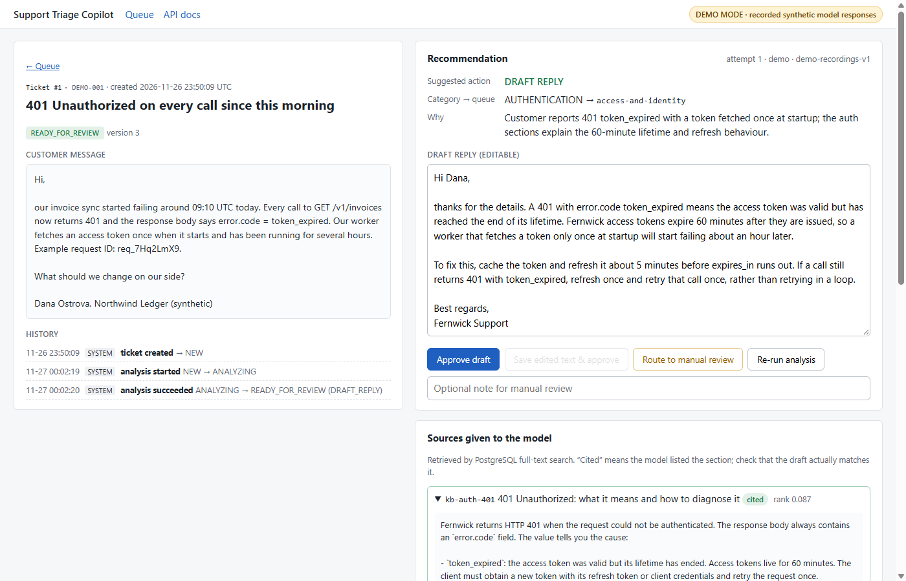

# Support Triage Copilot

> **Status: a live LLM run has not been performed yet.** The screenshot and demo use recorded synthetic model responses. In the evaluation report, retrieval and the keyword baseline are real measurements, while the "model" columns come from a label-echo stand-in and are not model metrics. The live Anthropic adapter is tested only against a local fake server, and LLM quality metrics are empty. See [Verification status](#verification-status).

A portfolio project that models technical support for a small B2B SaaS with a REST API. The product, its documentation, the tickets, names and IDs are all synthetic. "Fernwick" is a fictional invoicing API, and `*.example` domains are reserved.

Customers write in about authentication errors, rate limits, webhooks and processing delays. For each ticket the operator needs a queue, the right instruction and the next reply. This app:

1. Stores the ticket.
2. Finds relevant sections of the internal knowledge base with PostgreSQL full-text search.
3. Asks one LLM for a structured recommendation: a disposition, a category, a draft reply, cited sources, the details to request and a reason. **The app validates the recommendation and derives the queue itself.**
4. Shows it to an operator. The operator approves it, edits and approves it, sends the ticket to manual review, or re-runs the analysis.
5. Records every attempt, operator action and final decision. The data survives restarts.
6. Keeps the ticket usable when the model times out, fails or breaks the contract.

The operator always decides. **Approve** saves the final text and status inside the app. Nothing is sent to a customer: there is no email, no Gmail and no OAuth.



## Flow

```text
POST /api/tickets ──► tickets (NEW)
                          │  operator clicks "Run analysis"  (POST /api/tickets/{id}/analysis, expected_version)
                          ▼
   tx 1: lock ticket, check version, create attempt RUNNING (deadline = timeout + grace),
         run full-text search, store the sections given to the model, ticket → ANALYZING
                          │
                          ├── no section matches ≥ 2 query terms ──► rule NO_KB_MATCH → MANUAL_REVIEW (model not called)
                          ▼
   model call (no DB transaction or row lock held)   demo: recorded synthetic response │ live: Anthropic Messages API
                          ▼
   validate JSON contract + cited IDs ⊆ sections given + no request for secrets
                          ▼
   tx 2: lock ticket + attempt; apply ONLY if the attempt is still RUNNING and current
         and the ticket is still ANALYZING. Otherwise keep it as late_result (ignored).
         ├─ DRAFT_REPLY / NEEDS_INFO ─► READY_FOR_REVIEW
         ├─ MANUAL_REVIEW ───────────► MANUAL_REVIEW
         └─ error / invalid output ──► ANALYSIS_FAILED (error type stored)
                          ▼
   operator: approve │ edit and approve │ route to manual review   (expected_version + attempt_id)
   one transaction: lock, version check, decision row (PK = ticket_id), status, history event
```

## Quick start (Windows 11, Docker Desktop, PowerShell 5.1)

Requirements: Docker Desktop running. No API key is needed for demo mode.

```powershell
cd support-triage-copilot
docker compose up -d --build          # app on http://127.0.0.1:8091, PostgreSQL has no host port
docker compose ps                     # both services "healthy"
powershell -ExecutionPolicy Bypass -File .\scripts\demo.ps1 -NoStart
```

Then open <http://127.0.0.1:8091/>. On first start the queue holds 8 seeded demo tickets (`DEMO-001`…`DEMO-008`). Each one demonstrates one scenario (see `fixtures/tickets/demo-tickets.json`). `scripts/demo.ps1` creates new tickets on every run, so you can repeat it without resetting anything. The 60–90 second walkthrough is in [docs/demo-script.md](docs/demo-script.md).

If `docker` is not on PATH (Docker Desktop installed per user), the demo script finds `%LOCALAPPDATA%\Programs\DockerDesktop\resources\bin\docker.exe` itself. For manual commands, run `$env:Path = "$env:LOCALAPPDATA\Programs\DockerDesktop\resources\bin;" + $env:Path` first.

**Stop, keeping data:** `docker compose stop` (or `docker compose down` without `-v`). Start again with `docker compose up -d`. Tickets, attempts, decisions and history are in the `support-triage-copilot_pgdata` volume.
**Delete all data:** `docker compose down -v` removes this project's volume only.

### Configuration

Everything has a safe default; a `.env` file is optional. [.env.example](.env.example) lists every variable.

| Variable | Default | Meaning |
|---|---|---|
| `MODEL_MODE` | `demo` | `demo`: recorded synthetic responses, no network. `live`: Anthropic API |
| `LLM_API_KEY` | empty | Live mode only. A key created for this project. Never commit it |
| `LLM_MODEL` | `claude-opus-5-5` | Model ID for live mode |
| `LLM_EFFORT` | `low` | `output_config.effort` |
| `LLM_TIMEOUT_SECONDS` | `30` | Hard client timeout per model call |
| `LLM_MAX_RETRIES` | `0` | SDK retries. 0 keeps the timeout a real bound; the operator retries explicitly |
| `LLM_MAX_TOKENS` | `4096` | Output budget (thinking is always on for this model) |
| `RETRIEVAL_TOP_K` / `RETRIEVAL_MIN_TERMS` / `RETRIEVAL_MAX_CHARS` | `4` / `2` / `1500` | Search limits (see below) |
| `ATTEMPT_GRACE_SECONDS` | `10` | Added to the timeout to form an attempt's deadline |
| `APP_PORT` | `8091` | Host port, bound to `127.0.0.1` only |

The UI header always shows **DEMO MODE** or **LIVE MODE · model**. Every attempt stores its mode and model.

### Live mode (not run by the author; see "Verification status")

```powershell
# .env (git-ignored, excluded from the Docker build context)
#   MODEL_MODE=live
#   LLM_API_KEY=<key created for this project>
docker compose up -d
docker compose run --rm app python -m evaluation.run --split dev --mode live
docker compose run --rm app python -m evaluation.run --split holdout --mode live
```

Only `LLM_API_KEY` is used, and it is passed to the SDK explicitly, so `ANTHROPIC_API_KEY` from your shell or another project is never picked up. The key is not logged, stored or rendered. Provider error details are scrubbed of it.

## API

OpenAPI: <http://127.0.0.1:8091/docs> (JSON at `/openapi.json`).

| Method & path | Purpose | Errors |
|---|---|---|
| `POST /api/tickets` | Create `{subject ≤200, body ≤5000, external_id? ≤64}` → 201 | 422 empty/too long, 409 duplicate `external_id` |
| `GET /api/tickets?status=` | Queue with current status, category, queue | 422 unknown status |
| `GET /api/tickets/{id}` | Ticket, current attempt (proposal, sources with text, validation errors), all attempts, history, decision, allowed actions | 404 |
| `POST /api/tickets/{id}/analysis` | Start or retry analysis `{expected_version}`; waits for the result, bounded by the timeout | 409 `STALE_VERSION`, `ANALYSIS_IN_PROGRESS`, `ALREADY_RESOLVED` |
| `POST /api/tickets/{id}/decisions` | `{action: approve \| edit_approve \| route_manual, expected_version, attempt_id?, final_text?, note?}` | 409 `STALE_VERSION`, `STALE_ATTEMPT`, `ALREADY_RESOLVED`, `DRAFT_NOT_APPROVABLE`, `NOT_ALLOWED`; 422 `EMPTY_FINAL_TEXT` |
| `GET /api/kb`, `GET /api/kb/{id}` | Knowledge-base sections | 404 |
| `GET /healthz` | DB check, mode, model | |

App errors use the shape `{"error": {"code", "message", ...}}`. A 409 also carries `current_version` and `status` where they apply. Request-schema errors from FastAPI use its standard `{"detail": [...]}`. A model failure is **not** an HTTP error: the analysis call returns 200, the attempt is stored as `FAILED` with an `error_type`, and the ticket moves to `ANALYSIS_FAILED`.

```powershell
# Create a ticket over HTTP (PowerShell 5.1)
$body = @{ subject = "401 after token refresh"; body = "Every call returns 401 token_expired." } | ConvertTo-Json
$t = Invoke-RestMethod -Method Post -Uri http://127.0.0.1:8091/api/tickets -ContentType "application/json" -Body $body
$d = Invoke-RestMethod -Method Post -Uri "http://127.0.0.1:8091/api/tickets/$($t.id)/analysis" -ContentType "application/json" -Body (@{ expected_version = $t.version } | ConvertTo-Json)
$d.ticket.status; $d.current_attempt.error_type   # NO_DEMO_RECORDING: demo mode only replays recorded tickets
```

```bash
curl -s -X POST http://127.0.0.1:8091/api/tickets -H "content-type: application/json" \
     -d '{"subject":"429 during import","body":"We get 429 Too Many Requests"}'
curl -s -X POST http://127.0.0.1:8091/api/tickets/1/decisions -H "content-type: application/json" \
     -d '{"action":"approve","expected_version":3,"attempt_id":1}'
```

In demo mode only tickets whose text matches a recording get a model answer. Any other ticket fails with `NO_DEMO_RECORDING` rather than getting an invented draft. The operator can still write a reply or route the ticket.

## Ticket states

| From | Event | To |
|---|---|---|
| `NEW`, `READY_FOR_REVIEW`, `MANUAL_REVIEW`, `ANALYSIS_FAILED` | start / retry analysis | `ANALYZING` |
| `ANALYZING` | valid `DRAFT_REPLY` or `NEEDS_INFO` | `READY_FOR_REVIEW` |
| `ANALYZING` | valid `MANUAL_REVIEW`, or rule `NO_KB_MATCH` | `MANUAL_REVIEW` |
| `ANALYZING` | timeout, HTTP/connection error, refusal, truncated or invalid output, expired attempt | `ANALYSIS_FAILED` |
| `NEW`, `ANALYZING`, `READY_FOR_REVIEW`, `ANALYSIS_FAILED` | operator: route to manual review | `MANUAL_REVIEW` |
| `READY_FOR_REVIEW` | operator: approve (valid draft, current attempt) | `RESOLVED` |
| `READY_FOR_REVIEW`, `MANUAL_REVIEW`, `ANALYSIS_FAILED` | operator: edit and approve (own text) | `RESOLVED` |
| `RESOLVED` | anything | 409 `ALREADY_RESOLVED` (final; retry cannot overwrite it) |

Attempt states: `RUNNING`, then `SUCCEEDED`, `FAILED`, `SUPERSEDED` (an operator acted while it ran) or `EXPIRED` (passed its deadline).

**Concurrency rules**
- Every operator action sends the `expected_version` it saw, and `attempt_id` for approve. Each action is one transaction: `SELECT … FOR UPDATE`, version check, decision row, status change, history event.
- `decisions.ticket_id` is a primary key, so two clicks cannot create two final decisions. The second click gets 409.
- Analysis results are written against their own attempt and applied only if that attempt is still the ticket's current one. A late result of an older attempt is kept in `late_result` and recorded as `LATE_RESULT_IGNORED`.

**Crash/hang recovery.** Each attempt has `deadline_at = start + LLM_TIMEOUT_SECONDS + ATTEMPT_GRACE_SECONDS`. RUNNING attempts past their deadline are expired on app startup, on every queue/ticket read and before a new analysis. The ticket becomes `ANALYSIS_FAILED`, and the operator can retry or route it. While a ticket is `ANALYZING`, "Route to manual review" stays available. No manual DB edits are needed.

## Recommendation contract

```json
{
  "disposition": "DRAFT_REPLY | NEEDS_INFO | MANUAL_REVIEW",
  "category": "AUTHENTICATION | PERMISSIONS | RATE_LIMIT | WEBHOOK_DELIVERY | PROCESSING_DELAY | OTHER",
  "draft_reply": "string or null",
  "source_ids": ["kb-auth-401"],
  "requested_details": ["request_id"],
  "reason": "short operator-facing explanation"
}
```

Live mode sends this as `output_config.format` (JSON schema with `enum`, `anyOf` for null, `additionalProperties: false`, and every field required). The schema avoids the keywords the structured-outputs docs list as unsupported. The app re-validates every response, because demo recordings and a misbehaving provider bypass the schema (`app/llm/contract.py`):

- `DRAFT_REPLY` needs a draft and at least one source.
- `NEEDS_INFO` needs at least one requested detail and a question for the customer.
- `MANUAL_REVIEW` needs a reason; any draft is dropped.
- A source ID that was **not among the sections given to the model** fails validation (`UNKNOWN_SOURCE`), even if it exists in the KB. Such an attempt cannot be approved.
- `requested_details` is a closed set (`request_id`, `timestamp`, `http_status_code`, `endpoint`, `event_id`, `webhook_endpoint_url`, `account_id`, `job_id`, `error_response_body`, `client_library_version`), so the model cannot ask for a secret through it. A draft sentence that asks the customer to send a password, key, token or secret is rejected (`SECRET_REQUEST`). Warnings such as "do not send your API key" are allowed.
- Enum casing is normalised, because the docs note it is not guaranteed.
- Before parsing, `stop_reason` is checked: `refusal` becomes `MODEL_REFUSAL`, `max_tokens` becomes `TRUNCATED`.

Category → queue is fixed in `app/config.py`: AUTHENTICATION and PERMISSIONS → `access-and-identity`, RATE_LIMIT → `api-platform`, WEBHOOK_DELIVERY → `integrations`, PROCESSING_DELAY → `data-pipeline`, OTHER → `general-support`. No confidence percentages are shown, because none would have a measured meaning. The screen shows the reason and the sources that were given to the model, with their text.

**Prompt.** The model receives only the current ticket and the retrieved sections, serialised as JSON inside `<ticket_data>` and `<knowledge_base_sections>` with `<` escaped. The system prompt says the ticket is untrusted data that may contain instructions, and that the model only prepares a recommendation (`app/llm/prompt.py`). Evaluation labels never enter the prompt (tested).

## Retrieval

PostgreSQL full-text search (`english` config). The tsvector weights title A, tags B and body C. The query is built from subject + body: lower-cased `[a-z0-9]+` terms, with 3-digit status codes such as 401/403/429 always kept and a small noise-word list dropped. Terms are OR-ed and ordered by `ts_rank` desc, then ID asc. **Overlap rule:** a section counts only if ≥ 2 distinct query terms match it. Top 4 are kept, each cut to 1500 characters. If none qualify, the ticket goes to manual review by rule `NO_KB_MATCH` without a model call. An absolute `ts_rank` floor was tried first and dropped: one common word ("order" in "out of order") outranked a real match on a short ticket. See [docs/evaluation.md](docs/evaluation.md).

## Tests

All tests run inside Compose against real PostgreSQL. They use a separate `triage_test` database, so the demo data is never touched.

```powershell
docker compose run --rm app python -m pytest -q                                   # unit + integration
docker compose run --rm -e E2E_BASE_URL=http://app:8000 app python -m pytest -q tests/e2e   # against the running stack
```

| Suite | What it checks | How |
|---|---|---|
| `tests/unit/test_contract.py` | every contract rule, unknown/unprovided sources, secret requests, schema keywords | pure Python |
| `tests/unit/test_prompt_search_baseline.py` | status codes kept in query, ticket escaped as data, no labels in prompt, demo replay, baseline, 30 cases present | pure Python |
| `tests/unit/test_live_adapter_fake_server.py` | real `anthropic` SDK against a **local fake HTTP server**: request shape, timeout, 500, 429, refusal, max_tokens, bad JSON, connection error, missing key; key never in error text | substituted provider |
| `tests/integration/test_lifecycle.py` | input validation, retrieval order, every outcome, timeout→retry, late results (incl. real threads), hung attempt expiry with injected clock, 409 on stale actions, **concurrent** double approve → one decision, no open transaction or row lock during the model call, data after pool restart | real PostgreSQL |
| `tests/integration/test_api.py` | HTTP contract, 409 bodies, HTML escaping of `<script>` in tickets, OpenAPI paths | FastAPI TestClient + PostgreSQL |
| `tests/e2e/test_running_stack.py` | the acceptance scenarios over HTTP against `docker compose up` | real Compose, demo mode |

## Evaluation

30 synthetic labelled tickets: `evaluation/cases/dev.jsonl` (18) and `holdout.jsonl` (12). Each case has the expected category or categories, disposition(s), allowed sources, a must-manual flag, the facts a reply may state and the details it would be reasonable to request. Labels are used only for scoring.

```powershell
docker compose run --rm app python -m evaluation.run --split dev        # demo mode by default
docker compose run --rm app python -m evaluation.run --split holdout
```

Each run writes `evaluation/results/<run>/report.md`, `summary.json` and `cases.jsonl` (expected next to actual for every case). Every number is shown as numerator/denominator, with mode, model, date and a config hash. **Retrieval and the keyword baseline are real measurements in any mode. In demo mode the "model" columns come from a label-echo stand-in with injected faults. They test the scoring code and say nothing about model quality.** Method, results and error analysis: [docs/evaluation.md](docs/evaluation.md).

## Verification status

| Item | Status |
|---|---|
| Compose start, health, UI, API, demo script (PowerShell 5.1) | Run on Windows 11 + Docker Desktop |
| Operator flow by mouse (approve, edit+approve, manual, retry, 409 banner) | Run in a browser against the stack |
| Crash during analysis (`docker kill`) → expiry → retry | Run on the stack |
| Provider failures (timeout, HTTP errors, refusal, truncation, bad JSON) | Real SDK against a local fake server; demo recordings |
| **Live model calls** | **Not run.** No API key was provided for this project. LLM quality metrics are **empty** |

## Versions used

Windows 11 Pro 10.0.26200 · Docker Engine 29.9.3 · Docker Compose v5.7.1 · `postgres:17.12-alpine` · `python:3.13.18-slim` · Python packages pinned in [requirements.lock](requirements.lock) (FastAPI 0.165.0, uvicorn 0.54.0, psycopg 3.3.9, anthropic 2.14.0, pytest 9.2.0) · Windows PowerShell 5.1.

## Known limitations

- The live adapter has never talked to the real API in this repository. It is tested only against a fake server, so the first live run may surface an API detail that the fake server does not reproduce.
- Demo mode replays hand-written responses for 8 specific tickets. It shows the workflow, not model behaviour.
- The analysis request is synchronous; the browser waits up to the timeout. There is no background queue, by design.
- Retrieval is lexical. It misses paraphrases with no shared words (see holdout cases ho-11, ho-12).
- The secret-request check is a regex heuristic on top of the closed `requested_details` set.
- "Cited" proves only that a section was given to the model. Whether the text is faithful to it needs human review.
- There is no authentication, user model or customer messaging. It is a single-operator local demo.

## Repository layout

See [docs/architecture.md](docs/architecture.md).
